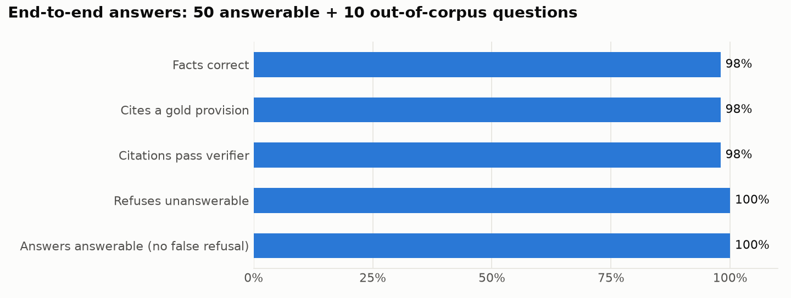

# AML Regulation Copilot

Author: Lodian Mier

A retrieval-augmented assistant that answers Philippine AML/CTF compliance questions **only from the regulations themselves**, cites the exact provision behind every claim, and **checks those citations deterministically** before showing the answer. A second mode maps an internal control or test case to the provisions it should satisfy and flags the gaps.

```
 2018 AMLA IRR (as amended Jan 2021)          2021 AMLC Registration and
 106 pages                                    Reporting Guidelines, Part 1
            \                                        /
             v                                      v
   +-----------------------------------------------------------+
   | ingest   manifest -> download -> SHA-256 provenance        |
   |          font-aware parse: footnotes (superseded wording)  |
   |          dropped; Rule > Section > subsection chunking     |
   +-----------------------------------------------------------+
                               |  330 chunks, each with a citable
                               v  address ("2018 IRR, Rule 22, Sec. 2")
   +-----------------------------------------------------------+
   | index    BM25  +  bge-small vectors in DuckDB   (local)    |
   +-----------------------------------------------------------+
                               |
   question ------------------>|
                               v
   +-----------------------------------------------------------+
   | retrieve hybrid (Reciprocal Rank Fusion) -> cross-encoder  |
   |          rerank (local) -> top 6 provisions                |
   +-----------------------------------------------------------+
                               |
                               v
   +-----------------------------------------------------------+
   | answer   Claude (via `claude -p` on a Claude plan) with    |
   |          numbered excerpts; must cite [n] or refuse        |
   +-----------------------------------------------------------+
                               |
                               v
   +-----------------------------------------------------------+
   | verify   every [n] exists · every quote is found in the    |
   |          block it cites · every claim sentence is cited    |
   +-----------------------------------------------------------+
```

## Problem / objective

Compliance teams answer the same regulatory questions again and again: how long they have to file an STR, which threshold makes a transaction covered, what enhanced due diligence actually requires. A generic chatbot answers these fluently and sometimes wrongly, and a wrong deadline is an audit finding. The goal was a copilot whose answers can be **audited**: every statement traceable to a provision and page, refusals when the regulations are silent, and an evaluation harness that measures all of this instead of asserting it.

## My specific contribution

I designed and built the whole system: the corpus selection and provenance manifest, the structure-aware parser and chunker, hybrid retrieval with reranking, the grounded-answer and control-mapping prompts, the deterministic citation verifier, a 60-question golden set written against the regulation text, the evaluation harness, the CLI and the Streamlit demo. It comes out of my day job automating AML compliance testing, where "the model said so" is never enough and every result has to be repeatable and traceable.

## Results

### Retrieval (no LLM involved)

50 answerable questions, each labelled with the provision(s) that answer it. Questions are paraphrased the way an analyst would ask them, not copied from the text.


| Retrieval (structure-aware chunks) | Right provision ranked 1st | In top 3 | MRR |
|---|---|---|---|
| BM25 only | 0.80 | 0.90 | 0.84 |
| Vectors only (bge-small) | 0.82 | 0.90 | 0.85 |
| Hybrid (RRF) | 0.82 | 0.90 | 0.86 |
| **Hybrid + cross-encoder rerank** | **0.90** | **0.98** | **0.93** |

**Chunking ablation.** Against fixed 300-word windows, structure-aware chunks put answer-bearing text first more often (0.88 vs 0.82 with hybrid + rerank), edge them at top 3 (0.98 vs 0.96), and do it with **53% less context** handed to the model (710 vs 1,500 words for the top 5). They also give every chunk an address a reviewer can check, which fixed windows cannot.

### End-to-end answers

All 60 questions run through the full pipeline on a Claude plan (median 10 s per answer).



| Metric | Result |
|---|---|
| Answer states every required fact (50 answerable) | **98%** |
| Answer cites a gold provision | **98%** |
| Answers whose citations all pass the deterministic verifier | **98%** |
| Correct refusals on out-of-corpus questions (10) | **10 / 10** |
| False refusals on answerable questions | **0 / 50** |

The out-of-corpus questions are deliberately close to the domain: Singapore thresholds, FinCEN deadlines, the FATF grey list, the current AMLC Executive Director, and the BSP's de minimis wire-transfer amount, which the IRR mentions but never states. The copilot declined all ten rather than answer from general knowledge.

**What the verifier caught.** Over three development runs the verifier, not the model, drove the improvements:

| Run | Change | Facts correct | Citations verified |
|---|---|---|---|
| 1 | first build | 100% | 86% |
| 2 | opening sentence must cite; verifier handles "…" and quote styles | 96% | 96% |
| 3 | guideline items (definitions, STR periods) chunked individually | 98% | 98% |

All three runs are graded with the same final answer patterns. The remaining two misses are real. In q06 the model merged wording from the IRR and the guidelines into a single "quote", and the verifier flagged it. In q34 retrieval does not surface the confidentiality provision for "can we tell the customer an STR was filed?", so the answer leans on the tipping-off rules instead. Run 2 also exposed a chunk boundary that split the TMS-alert determination period from its 60-day limit; the model then confused it with the 31-day run cap, which is what run 3 fixed.

## Design decisions worth knowing

- **Footnotes are removed by font size.** In the IRR, amended provisions carry footnotes quoting the *original* wording. Left in, the retriever happily serves superseded text as if it were current law. The body text is 12pt and footnotes 10pt, so the parser keeps spans at 11.5pt and above.
- **The 2001 Act itself is excluded.** The AMLC's copy of RA 9160 is the text as originally enacted (for example a PHP 4M covered-transaction threshold, since lowered to PHP 500k). The 2018 IRR restates the law as currently amended, so it is the authoritative source here. RA 11521 is also excluded: the published copy is a scanned image, and its amendments are already consolidated in the January 2021 IRR.
- **Deterministic checks around the LLM.** Retrieval, citation verification and the coverage table in the mapper are plain code. The model is only asked to judge and to write, and anything it quotes is checked against the source.
- **Strict grading, disclosed.** Gold provisions were labelled before any results and kept strict (an answer that cites the CDD tipping-off rule for a question about STR confidentiality still counts as a miss). Four answer patterns (q29, q33, q34, q39) were broadened after manual review showed they rejected correct paraphrases such as "exempt" for "not required"; every run above is re-graded with the final patterns. The golden set was also used during development, so treat these numbers as a regression baseline, not a held-out benchmark.
- **Runs on a subscription, not per-token billing.** Generation calls the `claude` CLI headless (`claude -p`), so evaluation runs count against a Claude plan's usage instead of API spend. Embeddings and reranking run locally. A usage limit pauses the eval, and rerunning resumes where it stopped.

## Corpus

| Source | Scope used | Why |
|---|---|---|
| [2018 IRR of RA 9160, as amended (Jan 2021)](https://www.amlc.gov.ph/laws) | Rules 1–35 | The operative rules: definitions, CDD, record-keeping, reporting, sanctions |
| [2021 AMLC Registration and Reporting Guidelines](https://www.insurance.gov.ph/wp-content/uploads/2023/03/2021-AMLC-REGISTRATION-AND-REPORTING-GUIDELINES.pdf) | Part 1 (pp. 2–17) | STR determination periods, reporting days, low-risk transactions. Parts 2–4 are portal and file-format manuals |
| FATF Recommendations | optional | The FATF site blocks scripted downloads; save it as `data/manual/fatf.pdf` to include it |

Source PDFs are not committed. `make data` downloads them and records URL, retrieval date and SHA-256 in `data/raw/provenance.json`.

## Run it

```bash
python -m venv .venv && source .venv/bin/activate
pip install -r requirements.txt
make index            # download, chunk and embed (first run downloads two small local models)
make test             # unit tests: chunking, fusion, citation verifier, refusal
make eval-retrieval   # retrieval ablation, no LLM

# answering needs the Claude Code CLI signed in to a Claude plan (`claude` then /login)
python copilot.py ask "When must an STR be filed, and what counts as the occurrence date?"
python copilot.py map "Monthly TMS run; analyst reviews alerts and escalates to the Compliance Officer"
make eval-answers     # end-to-end evaluation, resumable
make app              # Streamlit demo
```

## Repository layout

```
ingest/     download.py (manifest + provenance), parse.py (font-aware), chunk.py (hierarchy)
index/      store.py: DuckDB vectors + BM25
rag/        retrieve.py, fusion.py (RRF), answer.py, cite_check.py, mapper.py, llm.py
eval/       golden.yaml (60 questions), run_eval.py, charts.py, reports/
app/        streamlit_app.py
tests/      deterministic unit tests
docs/       charts and example sessions
```

## Limitations and next steps

- Two documents. The natural next additions are the BSP's AML regulations (MORB Part 8) and the Insurance Commission's AML circulars, which would bring in sector-specific rules.
- The golden set is 60 questions written by one person. It is a regression suite, not a benchmark, and a second annotator would make it stronger.
- Citations point to a provision and page, not to a paragraph highlight in the PDF.
- This is research support, not legal advice.
