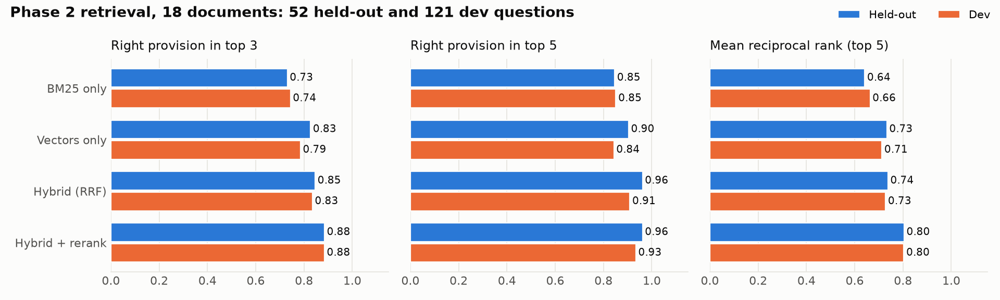
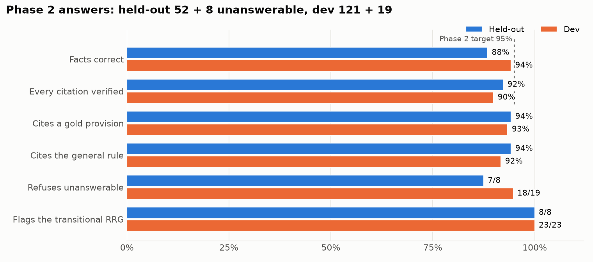
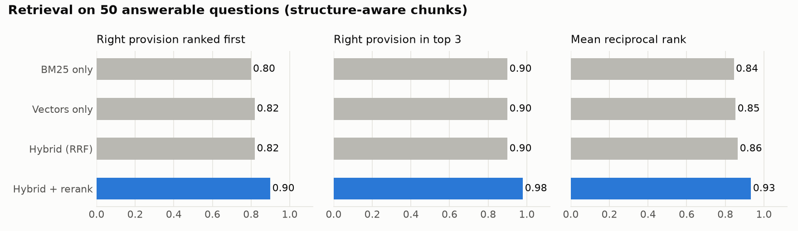

# AML Regulation Copilot

Author: Lodian Mier

A retrieval-augmented assistant that answers Philippine AML/CTF compliance questions **only from the regulations themselves**. It cites the exact provision behind every claim, **answers as of a date** with the provisions in force on that day, and **checks its citations deterministically** before showing the answer. A second mode maps an internal control or test case to the provisions it should satisfy and flags the gaps.

> **Status: Phase 2, the regulatory library, is built and evaluated, and its exit criteria are not yet met.**
>
> **The library:** 18 documents from all four Philippine AML regulators: AMLC, BSP, SEC and the Insurance Commission.
>
> **What meets the bar:**
> - Retrieval finds the governing provision in the top five for 96% of held-out questions, in well under a second.
> - Every date-specific behaviour holds on the held-out split: the right version is served and transitional rules are flagged.
>
> **What falls short:** fact accuracy (88%) and verified citations (92%) are below the 95% target. The causes and the next fixes are listed under [Results](#results).
>
> See [docs/production-plan.md](docs/production-plan.md) for the phased rollout.

```
 18 regulatory documents: AMLC, BSP, SEC, Insurance Commission
 (manifest: issuer, issue and effective dates, status, SHA-256)
            |
            v
   +-----------------------------------------------------------+
   | ingest   text layer, or on-device OCR for 7 scans (pages   |
   |          held for review when written-twice numbers        |
   |          disagree); a heading grammar per document layout, |
   |          checked for missed headings                       |
   +-----------------------------------------------------------+
                               |  1,580 chunks, each with a citable address
                               v  ("GoTRACS, Ch. I, Sec. 5, 5.4(c)(3)(viii)")
   +-----------------------------------------------------------+
   | version  each chunk carries the dates it was in force:     |
   |          two editions of the 2018 IRR compared word for    |
   |          word; amending circulars close what they replace; |
   |          the 2021 RRG marked transitional under GoTRACS    |
   +-----------------------------------------------------------+
                               |
   question, as of a date ---->|
                               v
   +-----------------------------------------------------------+
   | retrieve only provisions in force on that date; BM25 +     |
   |          bge-small vectors (RRF) -> cross-encoder rerank;  |
   |          a document or regulator named in the question is  |
   |          favoured; a transitional rule always comes with   |
   |          its replacement                                   |
   +-----------------------------------------------------------+
                               |
                               v
   +-----------------------------------------------------------+
   | answer   LLM (Claude) with numbered, status-labelled       |
   |          excerpts only; must cite [n], flag transitional   |
   |          rules, or reply NOT_IN_SOURCES                    |
   +-----------------------------------------------------------+
                               |
                               v
   +-----------------------------------------------------------+
   | verify   every [n] exists · every quote is found in the    |
   |          excerpt it cites · every claim sentence is cited  |
   +-----------------------------------------------------------+
```

**Presentation:** [project web page](docs/presentation/Mier_AML_Regulation_Copilot.html) (open locally).

## Problem / objective

Compliance teams answer the same regulatory questions again and again: how long they have to file an STR, which threshold makes a transaction covered, what enhanced due diligence actually requires. A generic chatbot answers these fluently and sometimes wrongly, and a wrong deadline is an audit finding. The rules also change. In December 2024 the AMLC repealed its 2021 reporting guidelines but kept them in force for up to three years while GoTRACS is adopted. A copilot that ignores dates will quote whichever text matches best.

The goal is a copilot whose answers can be **audited**. Every statement is traceable to a provision and the date it applied, and the copilot refuses when the regulations are silent. An evaluation harness measures all of this instead of asserting it.

The longer-term target is the compliance assurance workflow itself: mapping each control and automated test in a testing inventory to the regulatory requirements it evidences, so coverage gaps surface before an examiner finds them. Public regulations come first because results can be checked by anyone; internal documents come later, behind access controls.

## My specific contribution

I designed and built the whole system:

- the corpus selection and provenance manifest;
- the OCR path and its review gate;
- a structure-aware chunker with a heading grammar for each document layout, and a check for missed headings;
- effective-date versioning;
- hybrid retrieval with reranking;
- the grounded-answer and control-mapping prompts;
- the deterministic citation verifier;
- a 200-question golden set with a held-out split;
- the evaluation harness, the CLI and the Streamlit demo.

It comes out of my day job automating AML compliance testing, where "the model said so" is never enough and every result has to be repeatable and traceable.

## Results

### Phase 2: 18 documents, 200 questions

The golden set has 200 questions:

| Category | Questions |
|---|---|
| Pilot questions, relabelled for the library | 60 |
| New questions on every document | 140 |

The new 140 include:

- 8 same-question, two-date pairs;
- cross-regulator questions;
- 27 unanswerable questions in total, counting the pilot's.

**The held-out split.** 60 questions are held out, drawn only from the new questions and stratified by question type and issuer. They were never used while building, and were run once. The dev split (140) was used to tune; its retrieval figures for questions that name a source are flattered, because the bonus for named sources was set on dev. How the questions were checked is under [Design decisions](#design-decisions-worth-knowing).

#### Retrieval (no LLM involved)



| Hybrid + rerank, structure-aware chunks | Held-out (52) | Dev (121) |
|---|---|---|
| Right provision in top 1 / 3 / 5 | 0.71 / 0.88 / **0.96** | 0.71 / 0.88 / 0.93 |
| The general AMLC rule in top 5 (not only a sector restatement) | 0.96 | 0.92 |
| MRR (top 5) | 0.80 | 0.80 |
| Retrieval latency p50 / p95 | 0.33 s / **0.41 s** | 0.32 s / 0.37 s |

**Chunking ablation.** On held-out, structure-aware chunks put the required facts in the top 3 for 92% of questions, against 81% for fixed 300-word windows. They do it with about half the context: 795 words for the top 5, against 1,500.

#### End-to-end answers



| Metric | Held-out | Dev |
|---|---|---|
| Answer states every required fact | **46 / 52 (88%)** | 114 / 121 (94%) |
| Every citation passes the verifier | **48 / 52 (92%)** | 107 / 119 (90%) |
| Cites a gold provision | 49 / 52 | 113 / 121 |
| Refuses out-of-library questions | 7 / 8 | 18 / 19 |
| False refusals on answerable questions | 0 / 52 | 2 / 121 |
| Median time per answer | 17 s | 19 s |

#### Answering as of a date

| Check | Held-out | Dev |
|---|---|---|
| Two-date pairs answered correctly on both dates | **4 / 4** | 2 / 4 |
| Answers whose direct answer states the other date's rule as current | 0 / 8 | 0 / 8 |
| Answers citing a provision not in force on the question's date | 0 | 0 |
| Answers citing the transitional 2021 RRG that say so | 8 / 8 | 23 / 23 |

Both failed dev pairs are refusals, where retrieval missed the provision. No answer gave the wrong date's rule.

#### Where Phase 2 falls short, and why

All 11 held-out failures (6 facts, 4 citations, 1 refusal, across 10 answers) were read; none is a grading artefact.

**Lists (4 failures: 2 of 6 list questions correct).** A list is often split across several chunks. Retrieval then returns part of it, or a related provision from another document:

- n013 found one of the two grounds for declaring non-reporting days;
- b02 missed "credit bureaus" and "company registers";
- b01 and i05 answered from a different document than the one holding the list.

**Citation hygiene (4).** The model commented on the excerpts despite the instruction not to ("All of the above excerpts are marked CURRENT"), wrote an uncited opening sentence, or added a disclaimer.

**Details (2).** One answer confused the same-day STR after a sanctions freeze with the 24-hour freeze return. Another left out the 24-hour deadline.

**Out-of-library trap (1).** Asked what the SEC requires to register a lending company, the model answered from the SEC's customer-onboarding document list.

**Next fixes**, in order:

1. Retrieve a list's sibling items together, so list questions see whole lists.
2. Run a post-generation check that rewrites or flags comment-on-the-excerpts sentences and uncited summaries before the verifier runs.
3. Add an answerability check for questions whose evidence is about a different subject.

### Phase 1 pilot: 2 documents, 60 questions

The pilot used the 2018 IRR and the 2021 AMLC reporting guidelines (364 chunks). On its 50 answerable questions, hybrid retrieval with reranking ranked the right provision first for 90%, put it in the top 3 for 98%, and scored an MRR of 0.93.

End to end, 98% of answers stated every required fact and 98% passed the citation verifier, with 10 of 10 out-of-corpus questions refused. The pilot's questions were also used while building, so those figures were a regression baseline, not a held-out benchmark; Phase 2 adds the held-out split.



## Design decisions worth knowing

**The right version, filtered before ranking.**
- Each chunk carries `effective_from` / `effective_to`, and retrieval filters on the question's date before ranking. Superseded wording never reaches the prompt for a question about today.
- A question "as of" an earlier date gets the wording in force then.
- A transitional rule (the 2021 RRG under GoTRACS) is always retrieved together with the provision replacing it, and the answer has to say so.

**Two editions of the 2018 IRR are compared word for word, not by similarity.** A 98% similarity rule called a 640-word section unchanged although its wire-transfer deadline went from five working days to three. Identical words (ignoring case, punctuation and quote marks) mean the same text. Anything else is a new version, closed on the date its amendment took effect.

**Every threshold is tested against data.**
- **OCR:** Vision's confidence barely tracks OCR accuracy (rank correlation 0.26 on pages with a known text layer, degraded on purpose; [eval/ocr_calibration.py](eval/ocr_calibration.py)). So 0.80 is only a floor for unreadable pages.
- **Numbers:** a page is held for review when a spelled-out number and its digits disagree, as in "sixty (60)". That check caught a text layer whose amounts read "PhpSOO,OOO.OO".
- **Headings:** a check that every heading-shaped line is either matched or a listed exception catches a grammar that lost a level. The earlier coverage percentage could not.

**Questions that name a source are scoped to it.**
- "Under the 2018 IRR", "for a bank" or "the Insurance Commission's rules" pull extra candidates from those documents and earn a fixed reranker bonus.
- The bonus was set on dev (top-3 recall 0.85 → 0.88). It held on held-out.

**The golden set's grading is checked too.**
- The validator rejects a required fact that already appears in the question, or a number that could match inside another word ("20" in "2024").
- Citation markers are removed before facts are matched, so "[3]" cannot count as "three".
- A second review of 40 sampled questions found these problems, and I checked its rejects by hand. Fixes made after the dev run are listed separately in `eval/build/review_fixes.py`.

**Deterministic checks around the LLM.** Retrieval, versioning, citation verification and the mapper's coverage table are plain code. The model is only asked to judge and to write, and anything it quotes is checked against the text it was shown.

**Cheap to iterate.** Embeddings and reranking run locally. Generation goes through the `claude` CLI in headless mode (`claude -p`, behind one function in `rag/llm.py`), and evaluation runs are resumable when a usage limit is hit. Production swaps this for an API backend with enterprise data controls; nothing else changes.

## Corpus

**Effective dates.** These are the dates each document applies from. Where a document only says it takes effect on publication (or 15 days after), the approval date stands in, and can be early by a few weeks. Only SEC MC 4 states the publication date it counts from.

**The BSP manual.** Only the 2025 consolidated MORB is in the library, so BSP rules are unavailable for dates before 31 December 2025.

| Regulator | Documents (chunks) |
|---|---|
| **AMLC** (1,064) | 2018 IRR of RA 9160 (January 2021 consolidation, plus the 2018 edition for earlier dates); IRR of RA 10168 (TFPSA); 2021 Registration and Reporting Guidelines (transitional); GoTRACS 2024; 2021 DNFBP Guidelines; 2021 Sanctions Guidelines; 2018 Beneficial Ownership Guidelines; 2023 Sanctions Screening Guidance; 2017 Rules on Administrative Sanctions |
| **Insurance Commission** (306) | Circular Letters 2018-48, 2019-65 (replacing sections of 2018-48 on 22 Nov 2019), 2020-113, 2022-27, 2024-16 |
| **SEC** (115) | Memorandum Circular 16, s. 2018 (2018 AML/CFT Guidelines); MC 4, s. 2021 (amends Sec. 1.2) |
| **BSP** (95) | Manual of Regulations for Banks, Part IX (AML/CFT), as of 31 Dec 2025 |

Source PDFs are not committed. `make data` downloads them and records the URL, retrieval date and SHA-256 in `data/raw/provenance.json`. The BSP site blocks scripted downloads, so the MORB is saved by hand to `data/manual/`. [data/manifest.yaml](data/manifest.yaml) documents each date and its basis.

## Run it

Set up and check:

```bash
python -m venv .venv && source .venv/bin/activate
pip install -r requirements.txt
make index            # download, OCR, chunk and embed (first run downloads two small local models)
make test             # unit tests
python -m eval.validate_golden          # golden set against the built corpus
```

Ask questions and map controls. Answering uses the `claude` CLI (signed in) as the LLM backend.

```bash
python copilot.py ask "How long does a covered person have to establish suspicion from a TMS-generated alert?"
python copilot.py ask "Within what period must an STR be filed?" --as-of 2019-06-01
python copilot.py map "Monthly TMS run; analyst reviews alerts and escalates to the Compliance Officer"
make app              # Streamlit demo, with a date picker
```

Evaluate:

```bash
python -m eval.run_eval retrieval --split dev     # retrieval ablation, no LLM
python -m eval.run_eval answers --split dev       # end-to-end, resumable
python -m eval.run_eval answers --split heldout   # once per release
```

## Repository layout

```
ingest/     download.py (manifest + provenance), ocr.py, parse.py, chunk.py (heading grammars),
            coverage.py (missed-heading check), versions.py (effective dates)
index/      store.py: DuckDB vectors + BM25, filtered by date
rag/        retrieve.py, fusion.py (RRF), answer.py, cite_check.py, mapper.py, llm.py
eval/       golden.yaml (dev) and golden_heldout.yaml, validate_golden.py, run_eval.py,
            ocr_calibration.py, charts.py, build/ (how the set was made), review/, reports/
app/        streamlit_app.py
tests/      deterministic unit tests
docs/       production-plan.md, charts
```

## Current limitations

- Fact accuracy and verified citations are below 95% on the held-out split (88% and 92%); see the causes above.
- Effective dates often rest on approval dates, because most issuances do not print their publication date.
- The library holds only the 2025 consolidated BSP manual.
- The IRR's 2020 interim text is not in the library. A provision amended in both 2020 and 2021 shows its 2021 wording from 2020.
- The TFPSA IRR's five-day STR rule is closed on 29 January 2020 by an editorial decision (the later IRR rule governs), recorded in `ingest/versions.py`.
- The golden set's 200 questions were drafted by one person. A 40-question sample was reviewed a second time; the other 160 are covered only by the automatic grading checks.
- Citations point to a provision and page, not to a highlighted paragraph in the PDF.
- Research support for compliance analysts, not legal advice.

## Roadmap

| Phase | Scope | Exit criteria | Status |
|---|---|---|---|
| **1 · Pilot** | Public AMLC rules and guidelines, CLI and demo app, evaluation harness | ≥ 95% facts and verified citations, 100% refusal on out-of-corpus questions | Met |
| **2 · Regulatory library** | AMLC, BSP, IC and SEC issuances; OCR; effective-date versioning; 200-question golden set with a held-out split | ≥ 95% facts and verified citations on the held-out split; retrieval under 1 s | Latency met; facts 88%, citations 92% |
| **3 · Internal documents** | Policies, MTPP, control inventory and test scripts behind role-based access | Control mapping reviewed against an existing compliance testing inventory | |
| **4 · Production** | API LLM backend, managed vector store, logging and monitoring, evaluation gate in CI | Agreed SLOs and sign-off from compliance and information security | |

Details, risks and controls: [docs/production-plan.md](docs/production-plan.md).
